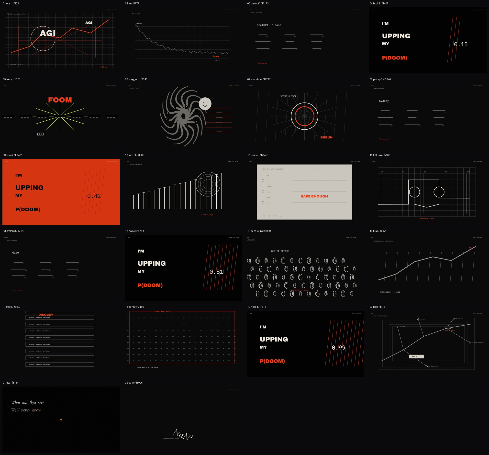

# pdoom-video — Native Blender Reconstruction

> ## ⚠️ 仓库作者重点说明
>
> **Kimi K 3.1制作视频的能力特别垃圾，完全比不过deepseek v-4.1 1017。提醒访客重新审视Kimi K3.1。**
>
> 以上是仓库作者基于本次视频重建任务的主观评价，不是标准化 benchmark。请访客结合本仓库的成片、工程、审查材料自行核验。

对 [mexicat/pdoom-video](https://github.com/mexicat/pdoom-video) 的独立 Blender 原生重建：22 个场景、9,399 帧、1080p60。

这是一个**重建版本**，不是逐像素复刻。原项目的 GLSL/SDF 光线步进画面被改写为 Blender 原生曲线、网格、程序材质和文字动画；画面结构、镜头意图、配色和关键转场尽量对齐，次要歌词排版与高频雕版细节有简化。

## 成片

- [pdoom_blender_1080p60.mp4](deliverables/pdoom_blender_1080p60.mp4)
- 1920×1080 / 60 fps / 9,399 帧 / 156.650 秒
- H.264 High Profile、yuv420p、BT.709
- AAC 320 kbps、48 kHz、立体声

[](reviews/full/encoded_contact_sheet.jpg)

## 工程入口

| 文件 | 内容 |
| --- | --- |
| [src/pdoom_master.blend](src/pdoom_master.blend) | 包含 22 个分场的主工程 |
| [src/scenes/](src/scenes/) | 22 个可独立打开和渲染的 `.blend` |
| [src/builders/](src/builders/) | 场景生成与重建脚本 |
| [src/timeline.json](src/timeline.json) | 22 场全局整数帧时间线 |
| [deliverables/reproduction_result.json](deliverables/reproduction_result.json) | 成片哈希、参数、验证与差异摘要 |
| [reviews/full/](reviews/full/) | 成片抽帧、场景联系表和审查记录 |
| [reviews/scene_*/](reviews/) | 四个门禁场景的同时间对照图与差异图 |

## 已验证

- 帧序列：9,399 / 9,399，零缺失、零无效
- 240 张抽样帧中无异常黑帧
- 从最终 MP4 解码复查 22 场中点，无黑帧
- 全片 FFmpeg 解码无错误
- 源帧循环首尾 MAE = 0；编码后 MAE ≈ 0.078（H.264 压缩误差）
- 成片 SHA-256：`0f5af32a277ba965eefab857c0e5d5c12ea78989845b6b60cb97ae5596920492`

完整参数见 [pdoom_blender_1080p60.ffprobe.json](deliverables/pdoom_blender_1080p60.ffprobe.json)。

## 复现

环境：Windows、Blender 5.2.2 LTS、Python 3.13、FFmpeg；审查脚本还需要 `opencv-python`、`numpy` 和 `Pillow`。

```bash
BLENDER="/c/Program Files/Blender Foundation/Blender 5.2/blender.exe"

# 生成 21 个程序化分场
"$BLENDER" -b --python-exit-code 1 --python src/builders/build_all.py

# Ilya 场景使用独立构建脚本
"$BLENDER" -b --python-exit-code 1 --python src/builders/build_ilya.py

# 渲染全部正式帧（约 9,399 帧）
python scripts/render_frames.py all --scale 100 --samples 8

# 帧连续性、黑帧检查
python scripts/check_sequence.py --final --samples 240

# 编码并验收
python scripts/encode.py
python scripts/validate.py
```

重建 22 场的主工程：

```bash
"$BLENDER" -b --python-exit-code 1 --python scripts/build_master.py
```

`scripts/encode.py` 默认读取 `assets/audio/pdoom.mp3`。该音频未包含在仓库中，完整重编码前需要自行提供本地文件。

## 已知差异

- 原项目以 WebGL + GLSL/SDF 实时生成，本项目使用 Blender EEVEE 和原生几何；两者细节纹理不可能逐像素一致。
- Shoggoth、paperclips、Ilya 和 outro 做了多轮视觉返工，但部分次要歌词、排版节奏和高频雕版纹样仍有简化。
- 对照基准是固定原项目版本生成的 66 张参考静帧，不是完整的原片逐帧对比。
- 原项目自动采样短片捕获超过一小时后仍未产出首段，因此已停止；README 不宣称完成全片参考视频对比。

## 素材与权利

- 本仓库不包含原项目源码仓库、原片参考视频、原始音频或歌词文件。
- `assets/fonts/` 和 `assets/plates/` 保留重建所需的字体、矢量素材与授权说明。
- 成片为视觉重建演示，其中包含来自原项目歌曲的音频片段。原项目代码与素材适用其自身授权；音频和歌词的权利不因原项目 MIT 许可证而自动覆盖。公开传播或再利用前请自行确认授权。
